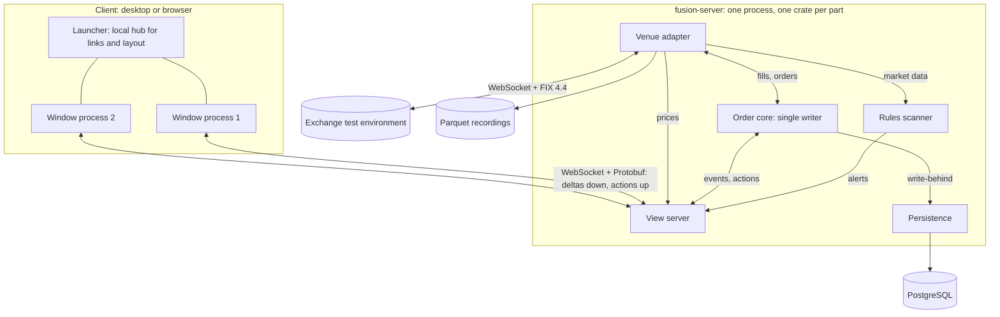

# Fusion architecture

Fusion is built in Rust end to end. The server does the work and the UI only
draws: the view server keeps every table, filters, sorts and groups it, and
sends each screen only the rows it can see. The first user is the author's own
trading, on one crypto exchange's test environment, with orders over FIX. A
product for others comes later.

## The parts

In a backtest a simulated venue replays the recordings in place of the
exchange, and nothing else changes.

## Decisions

| Layer | Pick | Why |
| --- | --- | --- |
| UI | egui, for desktop and browser from one code base | Mature on the web, fast with ticking data, simple runtime layouts. gpui-kit has better desktop components but its web build is "showcase only". A one-week side-by-side test confirms the pick at the start of milestone 2. |
| View server | Custom Rust, using the FINOS Vuu model | No open-source Rust view server exists. This is the core of the product. |
| Wire protocol | WebSocket with Protobuf (prost), checked by `buf breaking` | Independent of the UI library. |
| Expressions | CEL (`cel` crate) | One safe language for filters, computed columns and rules. |
| Venue | Binance Spot Testnet, FIX 4.4 | The only self-service crypto venue with FIX orders, market data and drop copy on a free testnet. |
| FIX engine | HotFIX with a small Logon fork, behind our own trait | Pure Rust. Plan B is quickfix-rs. |
| Order core | One single-writer thread for orders, risk and algos | Deterministic: replay and backtest equal live. |
| Rules | Declared features plus CEL conditions; alerts are a table | Features are shared across rules; alerts use normal viewports. |
| Algos | Native Rust house algos (TWAP first); user strategies as WASM later | Fast and trusted at home, sandboxed for user code. |
| Database | PostgreSQL 18 with sqlx, behind repository traits | Pluggable at the domain boundary, not at the driver. |
| Tick data | Parquet files | PostgreSQL is not for ticks. |
| Reference design | NautilusTrader, as a reference only | LGPL-3.0 and v2 is still a release candidate. |

## View server

- **Tables** keyed by primary key: instruments, prices, books, orders,
  executions, positions, alerts.
- **Viewport:** one client's window onto one table: visible row range,
  columns, sort, CEL filter and group-by. Only rows in range are sent.
- **Conflation:** each session keeps a set of changed rows and sends them at a
  fixed rate (default 20 per second, set per viewport).
- **Slow clients:** a bounded send queue per session. When it fills, drop the
  queued changes and send a fresh snapshot. Never block the core.
- **Actions:** new order, cancel, kill switch and save layout use the same
  connection, and get an ack or an error.
- **Protocol:** CreateViewport, ChangeViewport, Snapshot, Delta, RemoveRows,
  Action, Ack, Error. Each message carries a sequence number per viewport.
- **Order books:** the server subscribes in advance to the books of every
  instrument in any watchlist, so switching an L2 panel is fast.

## Client

The client is built from these blocks from the start, not later.

- **`client-core` crate:** protocol client, viewport cache, layout model, link
  routing, order-ticket logic and checks, hotkey map, price formatting and
  theme tokens. It has no UI library and no async runtime in it, so a second
  UI library can reuse it unchanged.
- **Desktop and browser:** the same UI crate builds natively and for wasm32.
  The browser build runs in CI from milestone 2.
- **One process per window.** A launcher starts one process per window and
  restarts a window that crashes. In the browser each tab is already a
  separate process, so both work the same way.
- **Local hub.** Windows send each other only small messages: context
  (FDC3-style, for example `fdc3.instrument`), layout changes and window
  commands. On desktop the launcher relays them over local pipes (named pipes
  on Windows, Unix sockets elsewhere); in the browser tabs use
  BroadcastChannel, with Web Locks to pick the layout owner. Data never goes
  window to window: each window gets it from the view server.
- **Configurable links.** A link is a rule in the layout: from a panel, a
  context type, to one or more panels, with a mode (`all`, `round-robin`,
  `last-focused`) and an optional gesture (for example Shift+click). Colour
  groups are a shortcut that creates links. Only a user action sends context,
  so links cannot loop. The hub keeps the last context per target panel.
- **Pop out and pop in.** Buttons, not drag tear-off. The layout remembers
  where a panel came from and where its window was. Closing a popped-out
  window pops it back in.
- **Own layout format:** windows, each window's dock tree, the panels and the
  links, versioned and saved in PostgreSQL. It does not depend on any UI
  library's format.
- **Theme as tokens:** background, panel, text, accent, buy, sell, up tick,
  down tick, warning, grid line, selected row. A colour-blind option for buy
  and sell, and a monospace font for prices.

## Orders and risk

- The order state machine is keyed on FIX OrdStatus (39) and ExecType (150),
  chains ClOrdID (11) and OrigClOrdID (41), and includes the pending states,
  unsolicited cancels, rejects and busts.
- Every change is an event in the journal, written to PostgreSQL behind the
  core. On restart: rebuild from events, then reconcile with the venue.
- Pre-trade checks before every order: instrument enabled with tick, lot and
  minimum notional respected; maximum value and quantity; a price collar;
  a message-rate limit; a position limit; duplicate detection.
- A kill switch (button and hotkey) cancels everything and blocks new orders.
- Prices and quantities use `rust_decimal`, never floats.

## Venue and FIX

Binance Spot Testnet for milestones 1 to 6: FIX 4.4 order entry, market data
and drop copy, self-service with a GitHub login.

- Logon needs an Ed25519 signature over tags 35, 49, 56, 34 and 52, so it is
  signed after MsgSeqNum and SendingTime are set. Also 553, 141=Y and 25035.
- Binance has no ResendRequest and no documented cancel-on-disconnect.
  Deribit's testnet has both, so Deribit is the second venue.
- Binance cut back its EU service from 1 July 2026. Choose the real-money
  venue (Deribit allows Sweden) before the last milestone.

## Rules and algos

- A scanner rule is a universe, declared features, a CEL condition and an
  action. Windowed features use time buckets in ring buffers per instrument.
- Only instruments with changed inputs are checked. Alerts fire on the edge,
  with hysteresis and a cooldown.
- House algos in native Rust: TWAP, then POV and iceberg, then VWAP, as
  parent and child orders. Every child order passes the risk checks.
- Rules and algos are versioned, never edited in place.

## Determinism rules

- The engine reads time only through the `Clock` trait in `fusion-domain`.
- No iteration over `std::collections::HashMap` or `HashSet` in core crates.
  Clippy enforces this per crate through `clippy.toml`.
- Timestamps are UTC nanoseconds in an `i64`.
- WASM user code runs with fuel in backtests and NaN canonicalisation on.

## Build order

Each milestone ends with a test you can run. Start the next one only when the
gate of the one before it passes.

| Milestone | Builds | Gate: done when |
| --- | --- | --- |
| M0 Skeleton | Workspace, CI, domain types, Clock, event journal, order state machine | State machine tests pass for every FIX status change |
| M1 Market data | Binance testnet WebSocket in, normalised trades, prices and books, Parquet recording | 24 hours with no gaps; replay rebuilds the same books |
| M2 View server and first screen | Viewports, conflation, the Protobuf protocol, `client-core`, a price grid on desktop and in the browser | 500 instruments at full tick rate; the UI keeps 60 frames a second |
| M3 Client building blocks | Launcher, one process per window, local hub, configurable links, pop out and pop in, layout saved in PostgreSQL | A watchlist click moves only the linked L2 panel in another window; a killed window comes back with its panels |
| M4 Orders over FIX | FIX session to the testnet, order ticket, blotter, risk checks, kill switch, order events in PostgreSQL | Place, replace and cancel work; a restart mid-order recovers state |
| M5 Rules scanner | Features, CEL conditions, alerts table and panel | A volume-spike rule fires correctly on recorded data |
| M6 Algos and backtest | TWAP, POV, iceberg; simulated venue on recordings | Backtest and testnet make the same decisions on the same events |
| M7 Small real money | Live with small limits, on a venue that serves Sweden | Two weeks live with no manual fixes |

## Later, for a product

Login and SSO, entitlements (Cedar fits), market-data licensing, MiFID II
algo controls, high availability, signed desktop builds. Cheap things done now
so these need no rewrite: a user id on every session, row filtering through
one function, UTC nanosecond timestamps on every event, a stable id on every
rule and algo version, and an append-only audit table.
